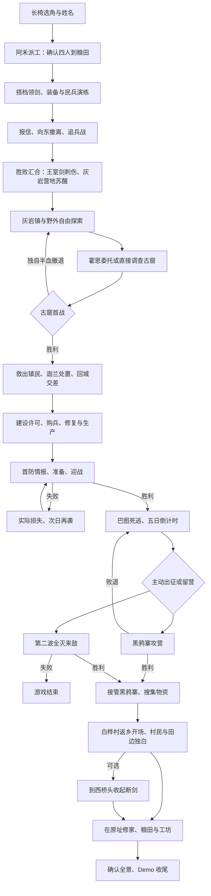

# 完整流程与分支图

## 主线

土匪窝点是独立支线副本；阿禾、阿铸招募和古窟首通接纳迦兰不强制全部完成。主线任一阶段的可选内容仍受真实设施、道路、人员与战果状态约束。

## 阶段标识与次序

| 运行阶段 | 进入事件 | 离开条件 |
| --- | --- | --- |
| PrologueBriefing | 序章新档；Intro 保存内部教学步骤 | 完成教学及报信告别 |
| PrologueEscape | 开始向东撤离 | 达到撤离触发条件 |
| ProloguePursuit | 追兵战确认 | 正常胜败均到重伤；主动放弃回撤离 |
| PrologueWounded | 王室剑刺伤演出 | 对白结束创建灰岩营地苏醒 |
| Waking | 灰岩营地苏醒 | 老周和春婶对白结束 |
| VisitLord | 可以自由探索 | 接委托或先完成救援 |
| RuinsAssigned | 霍恩正式委托 | 古窟首胜 |
| RuinsCleared | 控制来源被制伏、获得救援证据 | 霍恩交付成功 |
| RuinsDelivered | 建设许可与交付日记录 | 情报及首防推进 |
| DefenseWarned | 首防准备与通知 | 真实首防获胜 |
| DefenseWon | 巴图结局播放结束 | 攻寨或第二波取胜 |
| AttackWon | 接管黑鸦寨 | 原址修理三处设施，与麦田边村民交谈 |
| Finished | 全景确认收尾 | 保留已开放的活动 |

枚举值不是关卡排序；前四项序章阶段与经营阶段共用一个进度结构。重复对话读取证据、一次性标志和事件状态，不能只比较枚举数值。

## 跨场景约束

战前草案和待处理战果互斥。正式行军消耗游戏日，普通战斗只消耗战斗时间。进入非战斗地图后按新落点自动保存，确认开战前保存战前状态。角色姓名随档恢复。数值快照与队长口粮的读取见[存档设置](../01_系统规则/12_存档设置与退出.md#读取)。

地图尺寸、静态对象与出生点见[地图清单](地图数据/地图与对象清单.md)。每章列出运行补丁和阶段变化；底稿里的对象不等于该阶段全部可见对象。
